# DevOps Lifecycle Architecture Diagram — Insurance Verification Portal

**Project:** Containerized Insurance Document Verification Portal  
**Student:** Sourabh Shelke | **Roll No:** 23102C0029 | **Class:** BE CMPN  
**Subject:** DevOps Project (Academic Year 2026-27)  

---

## 🔄 End-to-End DevOps Lifecycle Workflow

```mermaid
flowchart LR
    subgraph Plan_and_Code ["1. Plan & Code"]
        A[Agile Backlog & User Stories] --> B[Feature Branching in Git]
        B --> C[Pull Request & Code Review]
    end

    subgraph CI_Pipeline ["2. Continuous Integration"]
        C --> D[Jenkins SCM Trigger / Polling]
        D --> E[Maven Clean & Compile]
        E --> F[Automated Test Quality Gate]
        F --> G[Package Standalone JAR]
    end

    subgraph Container_CD ["3. Continuous Delivery & Docker"]
        G --> H[Build Docker Image v1.0]
        H --> I[Tag & Push to Docker Hub]
        I --> J[Container Port Binding 8085]
    end

    subgraph Config_and_Monitor ["4. Configuration & Operations"]
        J --> K[Ansible Target Node Setup]
        K --> L[Idempotent Playbook Run]
        L --> M[Health Check /api/health]
        M --> N[Monitoring & Telemetry]
    end

    F -.->|Test Failure| O[Halt Deployment & Alert Dev]
```

---

## 🛠️ Detailed Stage Descriptions

1. **Plan & Code:** Features and user stories are planned in the backlog. Developers create feature branches (`feature/document-intake`), commit changes, and submit GitHub Pull Requests.
2. **Continuous Integration (CI):** Jenkins detects commits via SCM polling. It compiles the Java application and runs automated unit and integration tests. If tests fail, the quality gate immediately stops the pipeline.
3. **Continuous Delivery (CD) & Containerization:** Jenkins packages the verified code into a Spring Boot fat JAR, creates a Docker image tagged with the build number, and publishes it to the registry.
4. **Configuration Management & Provisioning:** Ansible provisions the target server environment, verifies prerequisites, deploys the container, and verifies health via HTTP endpoints.
