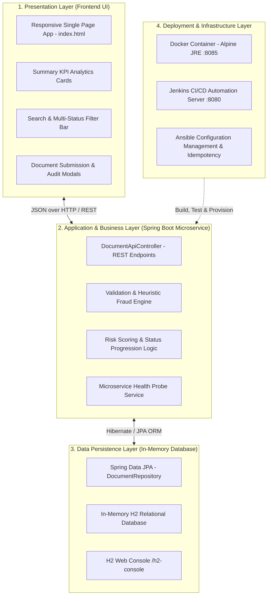

# System Architecture & Component Design — Insurance Verification Portal

**Project:** Containerized Insurance Document Verification Portal  
**Student:** Sourabh Shelke | **Roll No:** 23102C0029 | **Class:** BE CMPN  
**Subject:** DevOps Project (Academic Year 2026-27)  

---

## 🏛️ 3-Tier Layered Architecture

---

## 🧩 Architectural Highlights
1. **Separation of Concerns:** Loose coupling between the UI client, REST controllers, domain business logic, and repository layer.
2. **Stateless REST Services:** The Spring Boot backend exposes stateless REST endpoints allowing seamless horizontal scaling inside container clusters.
3. **Embedded Relational Persistence:** Embedded H2 database ensures lightning-fast boot times, zero external setup friction, and high operational reliability during automated tests.
4. **Isolated Microservice Containerization:** The application compiles into an executable fat JAR packaged into a lightweight Alpine Linux Docker container.

