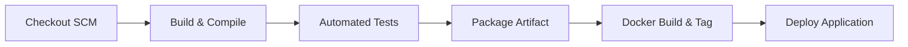

# Pipeline as Code Specification (Jenkinsfile) (Task 8)

**Project:** Containerized Insurance Document Verification Portal  
**Student:** Sourabh Shelke | **Roll No:** 23102C0029 | **Class:** BE CMPN  
**Subject:** DevOps Project (Academic Year 2026-27)  

---

## 🛠️ Pipeline Architecture & Stages

---

## ⚙️ Parameterized Pipeline Configurations
- **`DEPLOY_ENV`**: Choices `staging` or `production` (default: `staging`)
- **`APP_PORT`**: Parameterized application port (default: `8085` to avoid Jenkins 8080 collision)

---

## 📋 Declarative Stages Breakdown

1. **Stage 1: Checkout SCM**
   - Automatically checks out the current revision from GitHub using Git SCM credentials.
2. **Stage 2: Build & Compile**
   - Runs `mvn clean compile` to validate syntax and compile Java bytecode.
3. **Stage 3: Automated Tests (Quality Gate)**
   - Executes `mvn test` running the 6 automated integration tests and parses JUnit XML reports.
   - Any test failure immediately aborts downstream stages.
4. **Stage 4: Package Artifact**
   - Runs `mvn package -DskipTests` to assemble the executable Spring Boot JAR file.
   - Archives `target/insurance-verification-portal.jar` into Jenkins.
5. **Stage 5: Docker Build & Tag**
   - Builds container image tagged with `${BUILD_NUMBER}` and `latest`.
6. **Stage 6: Deploy Application**
   - Stops any stale container instances, launches fresh container mapped to `${APP_PORT}`, and verifies health.

